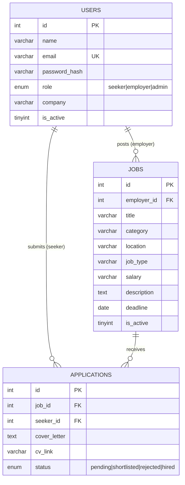

# Step 3: System Design

## 3.1 Architecture
Three-tier web application running on WAMP:

```
Browser (HTML/CSS)  <-->  Apache + PHP (pages, validation, auth)  <-->  MySQL database
```

## 3.2 Entity Relationship Diagram



Full SQL is in `database.sql`. A seeker can apply to a job only once (`UNIQUE KEY (job_id, seeker_id)`). Deleting a user or job removes related rows (`ON DELETE CASCADE`).

## 3.3 Pages
| Page | File | Access |
|---|---|---|
| Home / search | `index.php` | Public |
| Job details | `job.php?id=` | Public |
| Register / Login / Logout | `register.php`, `login.php`, `logout.php` | Public |
| Apply | `apply.php` (POST) | Seeker |
| My applications | `seeker/dashboard.php` | Seeker |
| My jobs | `employer/dashboard.php` | Employer |
| Post a job | `employer/post_job.php` | Employer |
| Applicants | `employer/applicants.php?id=` | Owner employer |
| Change status | `employer/set_status.php` (POST) | Owner employer |
| Open/close job | `employer/toggle_job.php` (POST) | Owner employer |
| Admin panel | `admin/index.php`, `toggle_user.php`, `toggle_job.php` | Admin |
| One-time setup | `install.php` | Delete after use |

## 3.4 Application flow (seeker)
```
Home -> Search -> Job details -> (not logged in? Login) -> CV link + cover letter
     -> Submit -> Saved as "pending" -> Employer changes status -> Seeker sees update
```

## 3.5 Security design
- Passwords hashed with `password_hash()` / checked with `password_verify()`
- CSRF token on every POST (checked centrally in `includes/functions.php`)
- Prepared statements for all SQL (prevents SQL injection)
- `htmlspecialchars` through the `e()` helper on all output (prevents XSS); CV links must start with http(s)
- Role checks on each page; ownership checks for employer data
- `session_regenerate_id()` on login and logout (prevents session fixation)
- `includes/.htaccess` blocks direct web access to the includes folder

## 3.6 UI layout
Top navigation bar (Jobs, role-specific links, Login/Logout), centred content column (max 980px), cards for jobs, tables for dashboards, coloured tags for status. Layout adapts to phone screens.
